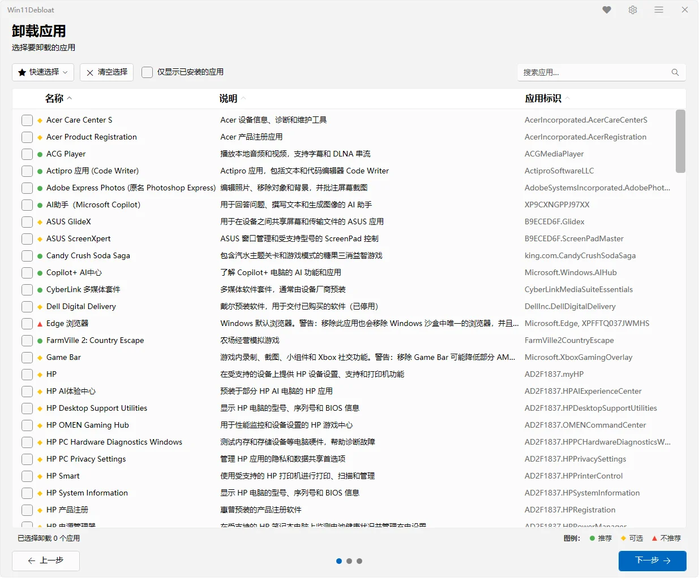
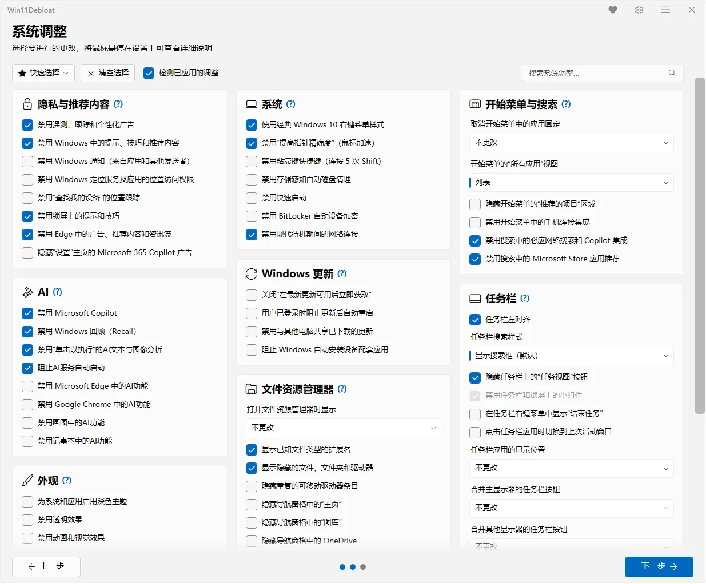
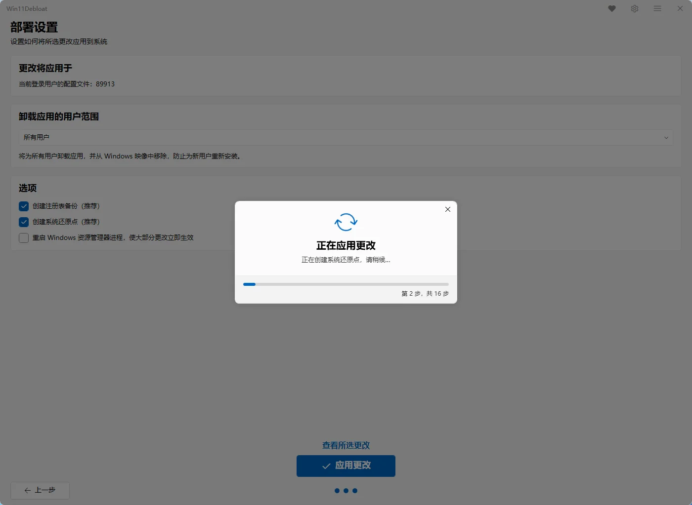

# Win11Debloat

> 图形化的 Windows 11 / 10 系统精简与优化工具，基于开源项目 Raphire/Win11Debloat 适配不忙脚本盒子。卸载预装应用、关闭遥测与推荐广告、禁用 Copilot / Recall 等 AI 功能、精简任务栏与开始菜单，全部在勾选界面里完成，一键应用、随时还原。

---

## 核心特性

- **图形化勾选界面**：按分类浏览所有可优化项，勾选后一键应用，无需记忆命令行参数
- **预装应用卸载**：批量移除系统自带应用、Xbox 游戏组件、厂商预装软件（HP / Dell / Lenovo / Samsung 等）
- **隐私与广告清理**：禁用遥测、诊断数据、活动历史、应用启动跟踪、个性化广告、锁屏提示与 Edge 广告
- **AI 功能关闭**：关闭并移除 Copilot、Recall、Click to Do，阻止 AI 服务开机自启，关闭 Edge / Chrome / 画图 / 记事本的 AI 功能
- **系统与更新优化**：关闭快速启动、BitLocker 自动加密、存储感知、更新后自动重启、传递优化等
- **外观与任务栏定制**：深色模式、关闭透明与动画、任务栏左对齐、隐藏搜索框 / 小组件 / 任务视图
- **开始菜单与资源管理器**：去除推荐内容、精简"所有应用"、显示文件扩展名与隐藏文件、调整资源管理器默认打开位置
- **安全可回滚**：应用前自动创建系统还原点、备份注册表，内置"还原备份"功能可一键恢复
- **配置导入导出**：把常用勾选方案导出为配置文件，换机或重装后直接导入复用
- **中文界面**：跟随系统语言自动切换，内置简体中文、繁体中文等多语言

---

### 界面预览

---

## 安装方法

本脚本的运行环境、依赖组件及图形化窗口均依赖"不忙脚本盒子"，建议仅通过盒子安装和使用本脚本。

> 前置条件：安装好 [不忙脚本盒子](https://www.bm-box.cn)

* 打开盒子 → **脚本市场** → 搜索 **「Win11Debloat」**
* 点击「安装」

---

## 使用方式

* 直接启动
  * 在盒子里点击 Win11Debloat 脚本卡片
  * 弹出 UAC 提示时点击「是」，授予管理员权限（脚本需要管理员权限才能修改系统设置）
  * 在首页选择要应用更改的用户，点击「默认模式」快速套用推荐设置，或点击「自定义设置」逐项挑选
  * 在「卸载应用」页勾选要移除的预装应用，在「系统调整」页按分类勾选优化项
  * 在「部署设置」页确认注册表备份、系统还原点等选项，点击「查看所选更改」核对后，点击「应用更改」
  * 等待执行完成，按提示重启资源管理器或重启系统使设置生效
* 右键启动
  * 在桌面或文件管理器的空白处右键 → 选择「Win11Debloat」
  * 后续步骤同上
* 快捷键启动
  * 在盒子中为该脚本设置全局快捷键，按下快捷键即可打开主界面

---

## 💡 使用提示

- **先备份再优化**：默认会创建注册表备份和系统还原点，不建议取消；如误删应用或想恢复设置，可在顶部菜单使用「恢复备份」
- **应用可重装**：绝大部分被卸载的应用都能通过 Microsoft Store 重新安装，注册表类改动也可以通过 Win11Debloat 自带的还原功能撤销
- **按需勾选**：不确定的选项先不要动，或先导出当前配置再尝试，确认效果后重新导入
- **变更可能需要重启**：部分外观、任务栏和资源管理器选项需要重启资源管理器或重启系统后生效
- **配置复用**：主界面支持导入 / 导出配置，适合给多台电脑套用同一套优化方案
- **高级用法**：脚本本身仍支持命令行、静默模式、Sysprep 模式等高级能力，详见[上游 Wiki](https://github.com/Raphire/Win11Debloat/wiki)

---

## 🖥️ 环境要求

| 项目 | 要求 |
| --- | --- |
| **操作系统** | Windows 10 1809+ / Windows 11（64 位） |
| **运行环境** | Windows PowerShell 5.1（不支持 PowerShell 7） |
| **权限** | 需要管理员权限（UAC 提权） |
| **可选组件** | Windows Terminal（未安装时自动使用 PowerShell 窗口） |

---

## 说明与致谢

本脚本基于 [Raphire/Win11Debloat](https://github.com/Raphire/Win11Debloat)，仅做了不忙脚本盒子适配、未修改上游项目任何代码。遵循 MIT 许可证。功能实现与界面归原作者所有，使用中遇到的问题可先查阅[上游 Wiki](https://github.com/Raphire/Win11Debloat/wiki)。
